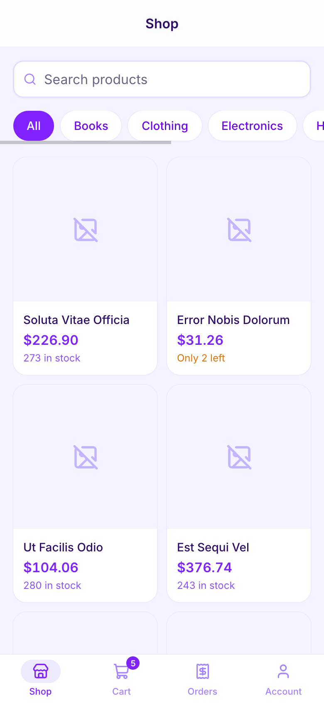
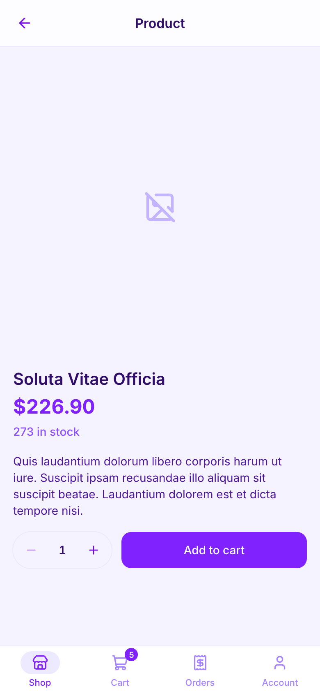
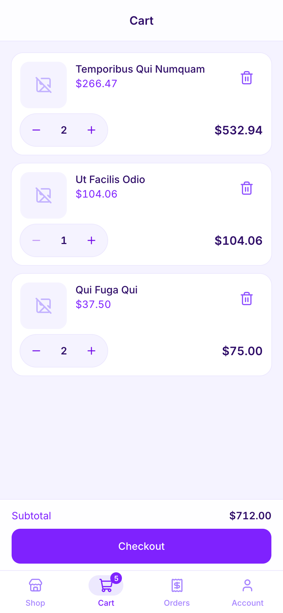
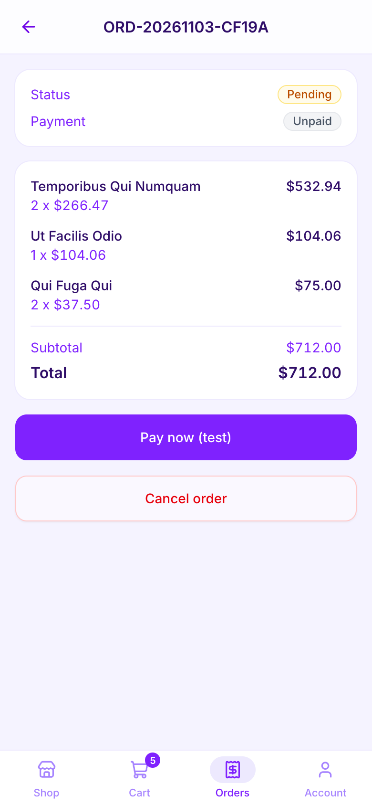
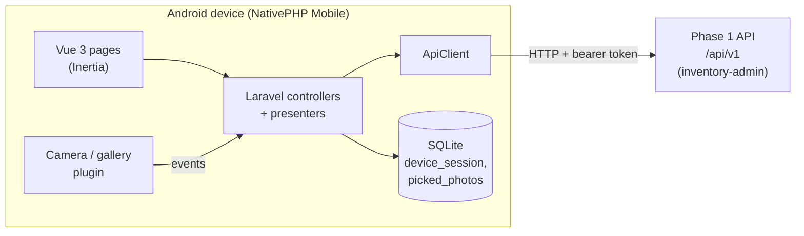

# Inventory Mobile

A native Android shop app built with Laravel and Vue on NativePHP Mobile, acting as a thin client for a separate inventory API.

[](https://github.com/timoy14/inventory-mobile/actions/workflows/tests.yml)


## What it does

- **Customers** browse and search the shop, manage a cart, check out, pay (test mode only) and track their orders.
- **Sellers** manage their own products, including photos from the device gallery or camera, and see the orders that contain their items.
- **No local shop data.** Products, carts, orders and prices all come from the Phase 1 API in [inventory-admin](https://github.com/timoy14/inventory-admin). The app never computes prices or totals.
- **Runs as a real Android app** through NativePHP Mobile, and in a normal browser for development.

## Screenshots

<table>
  <tr>
    <td align="center"><br><sub>Shop</sub></td>
    <td align="center"><br><sub>Product detail</sub></td>
    <td align="center"><br><sub>Cart</sub></td>
    <td align="center"><br><sub>Order and test payment</sub></td>
  </tr>
</table>

## Tech stack

| Layer    | Technology                                                                  |
| -------- | --------------------------------------------------------------------------- |
| Native   | NativePHP Mobile v4 (Android), `nativephp/mobile-camera` for gallery/camera |
| Backend  | Laravel 13, PHP 8.4                                                         |
| Frontend | Inertia v3, Vue 3 (JavaScript), Tailwind CSS v4, reka-ui, Lucide icons      |
| Build    | Vite+ (`vp`) for build, lint and format                                     |
| Storage  | Local SQLite for the device session and pending photos only                 |
| Quality  | Pest, PHPStan (Larastan, level 7), Laravel Pint, GitHub Actions             |

## Architecture

The app is a Laravel + Inertia application that NativePHP packages into an Android app. Every screen is rendered from data fetched over HTTP from the Phase 1 API, which lives in the [inventory-admin](https://github.com/timoy14/inventory-admin) repository.



- **`App\Services\Api\ApiClient`** wraps Laravel's HTTP client. It sends the bearer token, maps error responses to typed exceptions (unauthorized, suspended, validation, unavailable and so on), memoizes the cart for a request, and caches the public settings for 10 minutes.
- **Presenters** in `app/Support` shape API payloads into page props. Money stays as the strings the API returns.
- **Image URLs** that the API returns for `127.0.0.1` are rewritten to the configured API host, so the Android emulator can load them.
- **Offline handling.** The app is online only. If the API cannot be reached, screens show an "Offline" page with a retry button.

### How the token is stored

On login, the API token and the user are encrypted with Laravel's `Crypt` (the app key) and written to the `device_session` table in the app's SQLite database. If the stored value cannot be decrypted (for example after a reinstall), the user is treated as logged out and the table is cleared. Logging out calls the API and always clears the local session.

There is a single signed-in device session, so signing in as one user replaces the previous one.

### Test-mode payments

Payments are simulated. The checkout, pay and payment-complete screens show an amber banner with the message the API supplies ("This is a testing site only. No real payment will be taken."). A successful test payment gets a `TEST-` reference.

## Getting started

### Prerequisites

- PHP 8.4 and Composer
- Node 22 (or 20.19+) and npm
- The Phase 1 API (`inventory-admin`) running somewhere the app can reach
- For Android: JDK 17, the Android SDK (platform 35) and an emulator or device. Android Studio is not required; Gradle downloads the extra SDK pieces it needs (the NDK) on the first build.

All Composer packages, including NativePHP, install from public sources. No license key or private registry is needed.

### Install

```bash
git clone https://github.com/timoy14/inventory-mobile.git
cd inventory-mobile
composer setup
```

`composer setup` runs `composer install`, copies `.env.example` to `.env`, generates the app key, creates and migrates the SQLite database, then runs `npm install` and `npm run build`. The same steps by hand:

```bash
composer install
npm install
cp .env.example .env
php artisan key:generate
php artisan migrate
```

### Environment

| Key                 | Purpose                                                                                                                |
| ------------------- | ---------------------------------------------------------------------------------------------------------------------- |
| `INVENTORY_API_URL` | Phase 1 API base URL. Browser default: `http://127.0.0.1:8799/api/v1`. Android emulator: `http://10.0.2.2:8799/api/v1` |
| `NATIVEPHP_APP_ID`  | App id, default `com.inventory.marketplace`                                                                            |

`10.0.2.2` is how the Android emulator reaches the host machine's `127.0.0.1`.

### Run the Phase 1 API

Run it from a checkout of [inventory-admin](https://github.com/timoy14/inventory-admin) next to this one. To use a scratch database:

```bash
cd ../inventory-admin
DB_DATABASE=/abs/path/demo.sqlite php artisan migrate:fresh --seed --force
cd public
DB_DATABASE=/abs/path/demo.sqlite APP_ENV=local php -S 127.0.0.1:8799 \
  ../vendor/laravel/framework/src/Illuminate/Foundation/resources/server.php
```

Check it with `curl http://127.0.0.1:8799/api/v1/settings/public`.

- Do not use `php artisan serve` for this, because it drops `DB_DATABASE`.
- Login and register are rate limited to 6 per minute per IP.

### Run in the browser

```bash
npm run build
php artisan serve --port=8800
```

Open http://127.0.0.1:8800. For front-end work, run `npm run dev` alongside it.

### Run on Android

Set `INVENTORY_API_URL=http://10.0.2.2:8799/api/v1` in `.env` first (the value is bundled into the app), then:

```bash
export ANDROID_HOME=$HOME/Library/Android/sdk
export JAVA_HOME=$(/usr/libexec/java_home -v 17)
export PATH=$ANDROID_HOME/platform-tools:$ANDROID_HOME/emulator:$PATH

npm run build -- --mode=android
php artisan native:install android
emulator -avd Medium_Phone_API_35 -no-snapshot-save &
adb wait-for-device        # wait until: adb shell getprop sys.boot_completed  ->  1
php artisan native:run android emulator-5554 --no-tty
```

`adb devices` shows the serial to use. Restore the browser URL in `.env` afterwards.

Things to know:

- **The first build is slow** (about 10 minutes): Gradle downloads the NDK (about 2.4 GB), SDK platform 36 and build-tools 35. Keep several GB of disk free, because the emulator refuses to start with too little space.
- **The first app start is slow too.** The WebView showed "Loading..." for about 50 seconds.
- **Rebuild to see code changes.** The app is re-extracted from the bundle at each launch, so pushing files to the device does nothing. Run `native:run` again.
- **Build output is git-ignored:** the generated `nativephp/` directory, the `native` wrapper and `nativephp.lock`.

## Testing and quality

```bash
composer ci:check
```

This is what CI runs (after `composer setup`) on every push to `main` and every pull request. It runs, in order:

1. `npm run check`: Vite+ formatting and lint checks on the front end
2. `php artisan config:clear`
3. `pint --test`: PHP code style
4. `phpstan analyse`: static analysis with Larastan at level 7
5. `php artisan test`: the Pest test suite

Individual commands:

```bash
composer lint          # fix PHP style with Pint
npm run check:fix      # fix front-end formatting and lint
composer types:check   # PHPStan
php artisan test       # Pest
```

## Project structure

```text
app/
├── Http/Controllers/    Shop, cart, checkout, orders, seller products and orders, auth
├── Http/Middleware/     Signed-in and role checks
├── Listeners/           Stores photos picked through the native camera/gallery
├── Services/Api/        ApiClient and typed API exceptions
├── Services/Session/    Encrypted device session
└── Support/             Presenters, image URL rewriting, per-request state reset
resources/js/
├── pages/               Inertia pages (shop, cart, checkout, orders, seller, auth)
├── components/          App components and UI primitives
└── layouts/             App shell with the bottom tab bar
routes/web.php           All app routes
config/nativephp.php     NativePHP app id, runtime mode and build settings
tests/Feature/           Pest feature tests (the API is faked with Http::fake)
```

## Known limits

- **No iOS.** iOS has not been built or tested.
- **Photos.** Picking uses the NativePHP camera plugin when running natively (gallery or camera) and a normal file input in a browser. Picked file paths are kept in the app's SQLite database, confined to the app's media folders, sent with the product and then deleted.
- **Persistent runtime.** NativePHP boots Laravel once and reuses it for every request (`NATIVEPHP_RUNTIME_MODE`, default `persistent`), so state kept in singletons leaks between requests. A customer logout once ended in "500 - Too many redirects" on Android for exactly this reason: the customer-only `cart_count` shared prop outlived the request and called the API anonymously on the login page. `AppServiceProvider` now registers a `Runtime::onReset` hook (`App\Support\ResetRequestState`) that flushes Inertia shared props and scoped instances, `cartCount()` makes no call without a token, and a 401 on `/login` or `/register` renders an error page instead of redirecting to itself. Never keep per-request state in a singleton or static.
- **Verified on the Android emulator** (API on `10.0.2.2`): sign in, shop, product, cart, checkout banner, test payment with a `TEST-` reference, seller product list and form, and the native gallery picker (picked file accepted, uploaded, and its image URL rewritten and displayed). Not yet verified on a device: camera capture, editing or deleting a product, seller orders.

## Related projects

- [inventory-admin](https://github.com/timoy14/inventory-admin): the Laravel + Inertia admin panel and the Sanctum-secured Phase 1 API this app talks to.
- [real-estate-crm](https://github.com/timoy14/real-estate-crm): a Laravel CRM for a small real estate agency, with clients, properties, a deals board and a public listings site.
